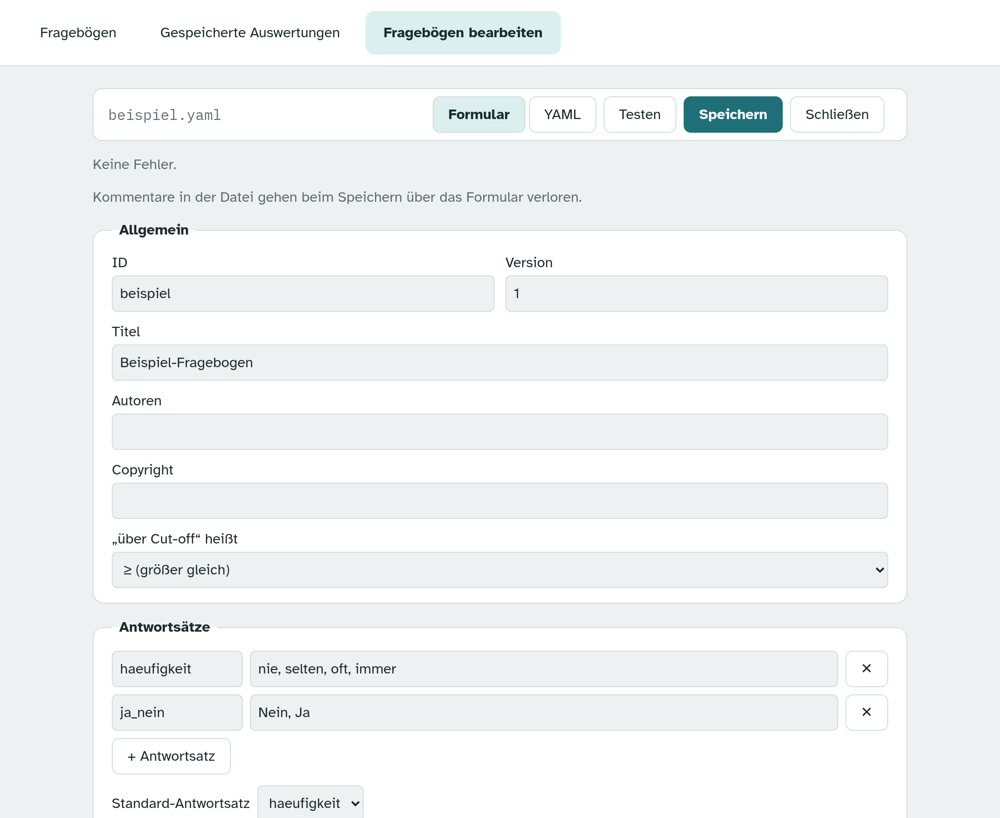

# Kreuzchen

Kreuzchen is a German-only desktop app (Tauri 2 + Svelte 5) that grades paper questionnaires. Questionnaires are defined in YAML; the app scores entered answers and shows a verdict. Its only network request is an update check against this repository's GitHub releases at start; it sends no questionnaire or patient data. Updates install only after the user confirms. Builds are not code-signed.

Install instructions for end users (German): [docs/installation.md](docs/installation.md).

Developers: build, test and release notes are in [DEVELOPMENT.md](DEVELOPMENT.md).

## Questionnaire schema

The reference example is [`examples/definitionen/beispiel.yaml`](examples/definitionen/beispiel.yaml). Top-level keys:

- `schema`, `id`, `version`, `title`: format version (currently `1`), a unique ID, the definition version and the display title.
- `cutoff_compare`: how scores are compared with cut-offs, `">="` or `">"`.
- `answer_sets`: named lists of answer labels, in order; the position is the answer value. `default_answers` names the set used by items that do not set `answers`.
- `shortcuts`: optional entry keys per answer set, one character per answer in order, e.g. `ja_nein: nj`. Sets without an entry use `0`, `1`, `2`, ….
- `keys`: named scoring tables. An item's `key` is a table name or an inline list mapping answer position to points (reverse-keyed items use e.g. `[3, 2, 1, 0]`).
- `fields`: patient/session inputs (`text`, `number`, `checkbox`) with an `id` usable in expressions.
- `scales`: scored groups with an `id`, `label` and optional `cutoff`. Items add their points to their `scale`.
- `derived`: computed values with an `id` and a `value` expression (e.g. `X + Y`), optionally with a `cutoff`.
- `sections`: the questionnaire pages, each with a `title`, optional `intro` and `items`. Items have a number `n` or an `id`, `text`, and optionally `scale`, `key` and `answers`.
- `result`: the IDs shown in the result table, in order.
- `rules`: named boolean expressions (`id`, `label`, `when`) that may reference earlier rules.
- `caveats`: notes shown when their `when` expression is true.
- `verdict`: ordered list; the first entry whose `when` is true gives the text; the entry with `else` is the fallback.

Expression names: `X` is the score of scale or derived value `X`; `X.cutoff` is its cut-off; `X.over` is true when it reaches the cut-off per `cutoff_compare`. Field IDs, item IDs and rule IDs are usable as variables, and `fehlend` is the number of unanswered items. Expressions support `+` and `/`, comparisons, `and`, `or` and `not`. Derived values may have decimals (e.g. a mean `K / 9`); results show at most two, as `3,67`.
